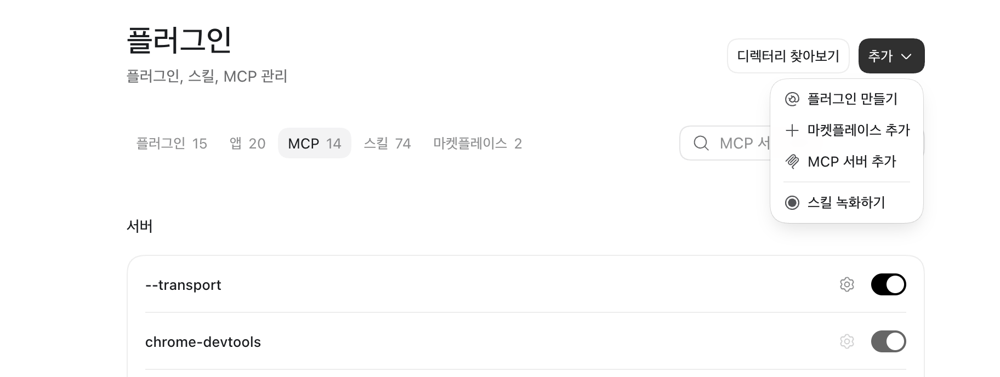
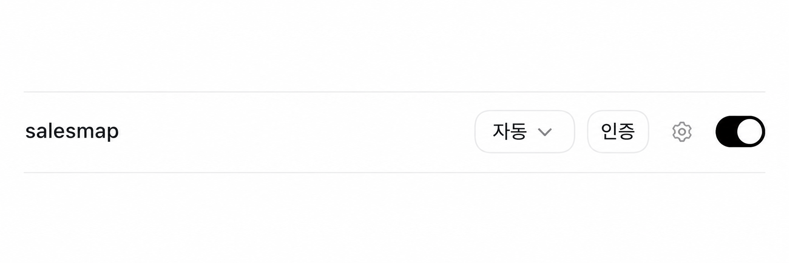
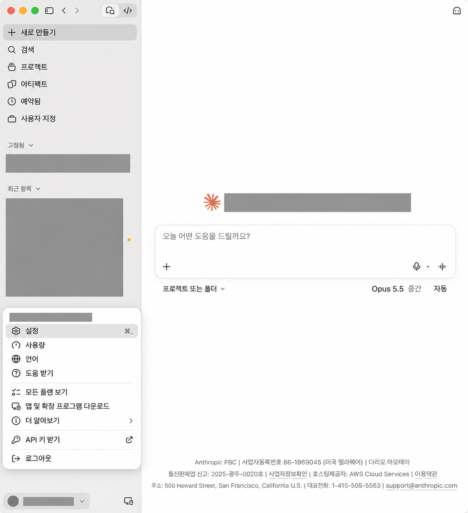
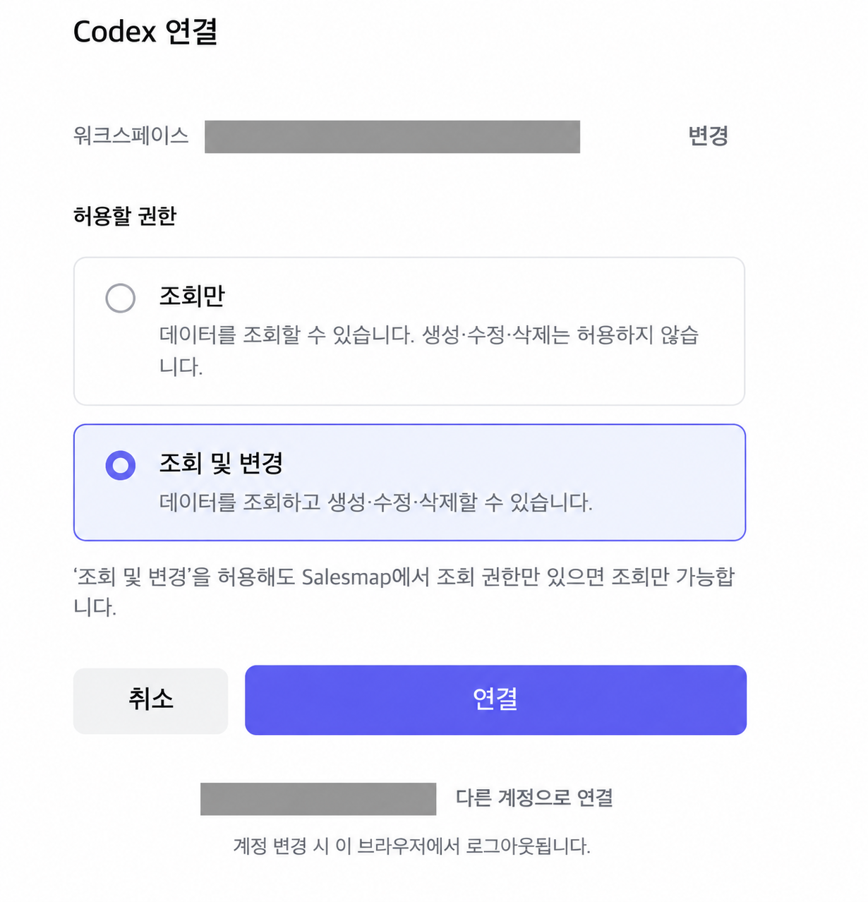
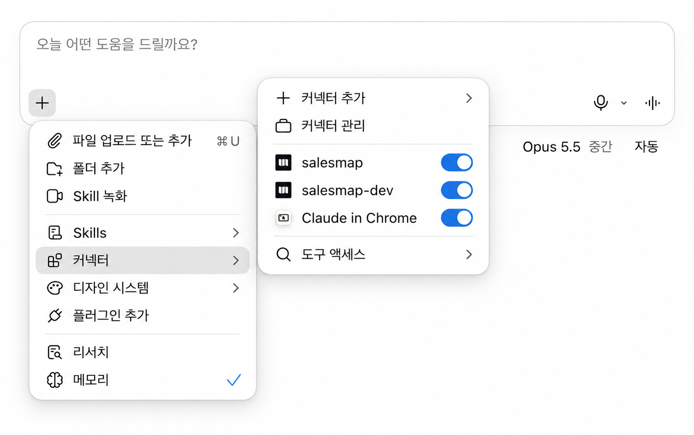
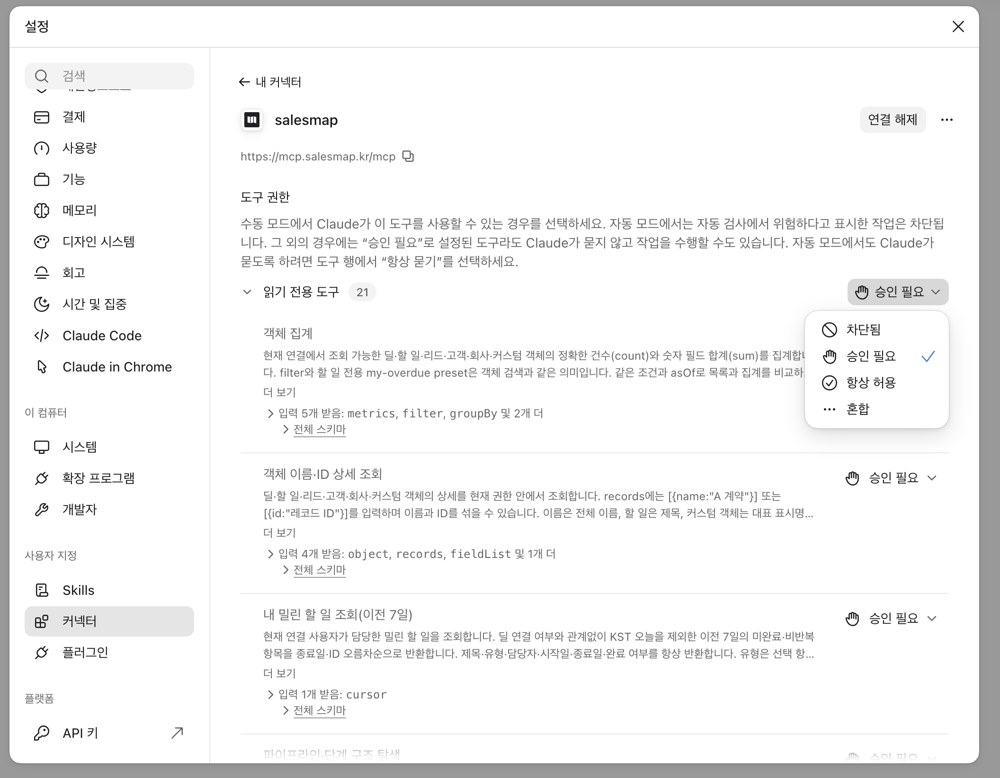

# 시작하기

현재 공개 디렉터리 등록 전이므로 **사용자 지정 MCP 연결**로 추가합니다. 세일즈맵 API 토큰을 만들거나 입력하지 않습니다.

### 1단계: 이용 조건 확인

- 세일즈맵 계정과 Professional 이상 플랜의 워크스페이스가 필요합니다.
- AI 서비스에서 사용자 지정 MCP 연결 기능을 사용할 수 있어야 합니다. 플랜·조직 설정에 따라 관리자의 허용이 필요할 수 있습니다.
- 회사가 IP 접근을 제한한다면 관리자에게 AI 서비스의 호출 IP 허용을 확인하세요. 웹 기반 AI 서비스는 내 컴퓨터가 아닌 서비스 서버에서 요청할 수 있습니다.

### 2단계: AI 서비스에 서버 추가

| 항목 | 입력값 |
| --- | --- |
| 이름 | 세일즈맵 |
| MCP 서버 URL | `https://mcp.salesmap.kr/mcp` |
| 인증 | OAuth / 로그인 |
| 전송 방식 | Streamable HTTP / 스트리밍 HTTP |



아래는 Codex 앱에서 MCP 서버를 직접 추가하는 방법입니다. 별도의 플러그인 패키지를 만들 필요는 없습니다.

**1. MCP 서버 추가 화면 열기**

Codex 앱을 열고 **맨 왼쪽 세로 메뉴에서 ‘플러그인’ 아이콘**을 누릅니다. 아이콘 위에 마우스를 올리면 아래 이미지처럼 **플러그인**이라는 이름이 표시됩니다.

<figure><figcaption>
‘플러그인’이라고 표시되는 아이콘을 눌러 연결 관리 화면을 엽니다.
</figcaption></figure>

플러그인 화면 상단에서 **MCP** 탭을 선택합니다. 오른쪽 위 **추가** 메뉴에서 MCP 서버 추가를 선택합니다.

<figure><figcaption>
MCP 탭에서 새 서버를 추가합니다.
</figcaption></figure>

**2. 이름·유형·URL 입력하기**

‘맞춤형 MCP에 연결’ 화면에 아래 값을 입력합니다.

| 항목 | 입력하거나 선택할 값 |
| --- | --- |
| 이름 | `salesmap` |
| 유형 | **스트리밍 가능한 HTTP** |
| URL | `https://mcp.salesmap.kr/mcp` |
| 기본 token 환경 변수 | 비워 둡니다. |
| 헤더 | 비워 둡니다. |
| 환경 변수의 헤더 | 비워 둡니다. |

회색으로 보이는 `MCP_BEARER_TOKEN`은 입력 예시입니다. 이 칸에 토큰이나 환경 변수 이름을 입력하지 않습니다. 화면 아래 **저장**을 누릅니다.

<figure><figcaption>
URL 끝의 /mcp까지 입력하고, 토큰·헤더 관련 항목은 비워 둡니다.
</figcaption></figure>

**3. 인증 시작하기**

MCP 서버 목록에서 방금 추가한 **salesmap**을 찾습니다. 오른쪽 스위치가 켜져 있는지 확인하고 **인증**을 누릅니다. 옆의 ‘자동’ 선택 항목은 그대로 두어도 됩니다.

<figure><figcaption>
저장만으로 로그인이 끝나지 않습니다. 인증 버튼을 눌러 연결을 진행합니다.
</figcaption></figure>

브라우저가 열리면 아래 **3단계: 세일즈맵 로그인과 권한 동의**를 진행합니다. 완료 후 Codex 앱으로 돌아와 **4단계: 연결 확인**의 요청을 보내세요.


1. [ChatGPT 플러그인](https://chatgpt.com/plugins)을 엽니다.
2. **추가(+) → 사용자 지정 MCP 서버 추가(Add custom MCP server)**를 선택합니다.
3. 이름과 위 서버 URL을 입력하고 인증은 **OAuth**로 선택합니다.
4. 안내된 주의사항을 확인하고 **플러그인으로 만들기(Create as a plugin)**를 진행합니다.
5. 로그인 창이 열리면 아래 **3단계**에 따라 세일즈맵 연결을 승인합니다. 도구 목록을 확인하고, 설치한 연결을 대화에서 선택합니다.

메뉴 이름은 언어·앱 버전에 따라 다를 수 있습니다. 서버 추가 메뉴가 없으면 계정·워크스페이스의 사용자 지정 MCP 생성 권한을 확인하세요. 조직 구성원은 관리자가 추가한 연결에서 본인의 세일즈맵 계정으로 로그인해야 할 수 있습니다.


아래는 Claude 데스크톱 앱 기준입니다. 웹·앱 버전과 조직 정책에 따라 메뉴 이름이나 위치가 다를 수 있습니다.

**1. 설정 열기**

Claude 앱을 열고 **왼쪽 아래의 계정 이름**을 누릅니다. 펼쳐진 메뉴에서 **설정**을 선택합니다.

<figure><figcaption>
계정 메뉴의 설정을 누릅니다.
</figcaption></figure>

**2. 커스텀 커넥터 추가하기**

설정 왼쪽 메뉴의 **커넥터**를 선택합니다. 오른쪽 위 **추가 → 커스텀 커넥터 추가**를 누릅니다.

<figure><figcaption>
이미 등록된 목록과 별개로 새 커넥터를 추가합니다.
</figcaption></figure>

**3. 이름과 URL 입력하기**

첫 번째 입력란에 `salesmap`, 서버 주소 입력란에 `https://mcp.salesmap.kr/mcp`를 입력하고 오른쪽 아래 **계속**을 누릅니다.

<figure><figcaption>
서버 주소는 /mcp까지 입력합니다.
</figcaption></figure>

**4. 인증 설정 확인 후 추가하기**

다음 화면에서 아래 설정을 확인합니다.

| 항목 | 선택하거나 입력할 값 |
| --- | --- |
| 인증 | **지금 로그인** |
| OAuth 클라이언트 | **자동으로 등록** |
| 요청 헤더 | 추가하지 않습니다. |
| 고급 | 변경하지 않습니다. |

**로그인 없음**이나 **자체 OAuth 클라이언트 사용**을 선택하지 않습니다. API 키·토큰·클라이언트 ID·Secret을 직접 입력할 필요가 없습니다. 설정을 확인한 뒤 **화면 맨 아래 오른쪽의 추가**를 누릅니다. 버튼이 보이지 않으면 화면을 아래로 스크롤하세요.

<figure><figcaption>
설정 확인 후 맨 아래 추가 버튼을 눌러야 저장됩니다.
</figcaption></figure>

**5. 세일즈맵에 연결하기**

커넥터 화면의 `https://mcp.salesmap.kr/mcp` 주소와 **salesmap: 아직 연결되지 않았습니다.** 안내를 확인합니다. 그 아래 **연결**을 누릅니다. 커넥터를 추가한 것과 세일즈맵 로그인을 마친 것은 별개입니다.

<figure><figcaption>
연결을 눌러 브라우저에서 세일즈맵 로그인을 시작합니다.
</figcaption></figure>

브라우저가 열리면 아래 **3단계: 세일즈맵 로그인과 권한 동의**를 진행합니다. 승인 후 Claude 앱으로 돌아오는 화면도 같은 단계에서 안내합니다.

Team·Enterprise 등 조직 계정에서는 관리자가 먼저 조직의 커넥터에 추가해야 할 수 있습니다. 구성원은 추가된 세일즈맵 커넥터에서 각자 로그인합니다.



다른 MCP 클라이언트에서도 **원격 Streamable HTTP와 OAuth 로그인**을 지원하는지 확인하고 같은 서버 주소를 사용하세요. API 토큰을 Authorization 헤더에 넣는 이전 연결 설정은 새 서버의 연결 방식이 아닙니다.

### 3단계: 세일즈맵 로그인과 권한 동의

**1. 로그인하기**

브라우저에서 세일즈맵 로그인 화면이 열립니다. 평소 사용하는 Google 계정으로 로그인하거나 이메일을 입력하고 **시작하기**를 눌러 로그인을 마칩니다. 이미 로그인한 상태라면 다음 화면으로 바로 이동할 수 있습니다.

<figure><figcaption>
API 토큰이 아니라 세일즈맵 계정으로 로그인합니다.
</figcaption></figure>

**2. 워크스페이스 선택하기**

연결할 워크스페이스를 목록에서 선택하고 **워크스페이스 선택**을 누릅니다. 화면 아래 로그인 계정을 확인하고, 다른 계정이 필요하면 **다른 계정으로 연결**을 선택합니다. 계정을 변경하면 해당 브라우저의 세일즈맵에서 로그아웃됩니다.

<figure><figcaption>
목록에서 실제로 작업할 워크스페이스를 선택하세요. 예시의 이름과 계정은 가렸습니다.
</figcaption></figure>

**3. 허용할 권한 선택하기**

연결 화면에서 워크스페이스를 다시 확인합니다. 잘못 골랐다면 옆의 **변경**을 누릅니다. 필요한 권한을 선택하고 **연결**을 누릅니다.

- **조회만**: 검색·조회·집계에 사용합니다.
- **조회 및 변경**: 생성·수정·삭제가 필요할 때 선택합니다. 클라이언트가 조회만 요청한 연결에서는 변경 권한 선택이 표시되지 않을 수 있습니다.

<figure><figcaption>
상단에는 연결하는 AI 서비스 이름이 표시됩니다. 이 예시는 Codex입니다.
</figcaption></figure>

**4. 인증 완료 확인하기**



브라우저에 **Authentication complete. You may close this window.**가 표시되면 인증이 완료된 것입니다. 브라우저 창을 닫고 Codex 앱으로 돌아갑니다.

<figure><figcaption>
인증 완료 메시지를 확인한 뒤 앱으로 돌아가세요.
</figcaption></figure>


세일즈맵에서 연결을 승인한 뒤 **커넥터 연결을 완료하시겠습니까?** 화면이 나타나면, 본인이 Claude 앱에서 시작한 연결인지 확인하고 **계속 연결**을 누릅니다.

<figure><figcaption>
직접 시작한 연결이라면 계속 연결을 누릅니다.
</figcaption></figure>

**연결됨** 화면에서 브라우저가 **Claude을(를) 여시겠습니까?**라고 물으면 **Claude 열기**를 누릅니다. 브라우저가 별도로 묻지 않으면 **데스크톱 앱 열기**를 누르거나 Claude 앱으로 돌아갑니다. ‘항상 허용’ 체크는 연결을 완료하기 위한 필수 항목이 아닙니다.

<figure><figcaption>
Claude 앱으로 돌아가 연결 확인 요청을 보냅니다.
</figcaption></figure>


연결 승인을 마치면 안내에 따라 ChatGPT로 돌아가 세일즈맵 연결을 확인합니다.




‘조회 및 변경’을 허용해도 Salesmap에서 조회 권한만 있으면 조회만 가능합니다. 로그인 비밀번호나 토큰을 AI 대화창에 보내지 마세요.


### 4단계: 연결 확인

**Codex 앱**에서는 앱으로 돌아온 뒤 **새 채팅**을 열고 다음 요청을 입력합니다. 앞서 MCP 목록에서 `salesmap`의 스위치를 켰다면 별도의 플러그인 패키지를 만들거나 선택하는 절차는 필요하지 않습니다.

**Claude 앱**에서는 새 대화를 열고 아래 순서로 확인합니다.

1. 대화 입력창 **왼쪽 아래의 + 버튼**을 누릅니다.
2. 펼쳐진 메뉴의 **커넥터**에 마우스를 올립니다.
3. `salesmap` 오른쪽 스위치가 **파란색으로 켜져 있는지** 확인합니다. 이미 켜져 있으면 그대로 두고, 꺼져 있으면 눌러 켭니다.
4. 메뉴 바깥을 눌러 닫고 아래 연결 확인 요청을 입력합니다.

<figure><figcaption>
salesmap 스위치가 켜져 있으면 바로 요청할 수 있습니다. 다른 커넥터는 함께 켤 필요가 없습니다.
</figcaption></figure>

**ChatGPT**에서는 대화에 사용할 세일즈맵 연결을 선택하거나 활성화한 뒤 같은 요청을 입력합니다.

> 지금 연결된 세일즈맵 계정과 워크스페이스를 알려줘.

응답에 나온 계정·워크스페이스가 의도한 대상과 같은지 확인합니다. 정보가 표시되지 않으면 아래 문제 해결의 ‘AI가 세일즈맵 도구를 찾지 못함’을 확인하세요. 계정·워크스페이스가 맞으면 조회를 시작할 수 있습니다.

> 내가 담당하는 딜의 이름과 금액, 세일즈맵 링크를 보여줘.


[use-cases.md](use-cases.md)


### Claude 앱의 도구 실행 승인 설정

연결 후 실행 전에 물어볼지를 바꾸려면 아래 순서로 설정을 엽니다. 처음 연결할 때 반드시 변경할 필요는 없습니다.

1. 대화 입력창 왼쪽 아래 **+** 버튼을 누르고 **커넥터**에 마우스를 올립니다.
2. **커넥터 관리**를 누르고 목록에서 **salesmap**을 선택합니다.
3. **도구 권한**에서 변경할 도구 오른쪽의 승인 메뉴를 엽니다. 도구 묶음의 메뉴에서는 여러 도구의 설정을 함께 바꿀 수 있습니다.

| 설정 | 의미 |
| --- | --- |
| 차단됨 | 해당 도구를 사용하지 못합니다. |
| 승인 필요 | 수동 모드에서는 실행 전 승인을 요청합니다. 자동 모드에서는 묻지 않고 실행할 수 있습니다. |
| 항상 허용 | 실행할 때마다 승인받지 않고 사용할 수 있습니다. |
| 혼합 | 묶음 안의 도구별 설정이 서로 다른 상태입니다. |

<figure><figcaption>
도구별로 실행 승인 방식을 확인하거나 바꿀 수 있습니다.
</figcaption></figure>

처음에는 기본 설정을 유지해도 됩니다. 자동 모드에서도 실행 전에 반드시 확인받으려면 **개별 도구 행에서 항상 묻기**를 선택하세요. 생성·수정·삭제 도구를 사용할 때는 특히 이 설정을 확인하세요.

이 설정은 **Claude가 실행 전에 물어볼지**를 정합니다. 세일즈맵 연결에서 동의한 ‘조회만 / 조회 및 변경’이나 Salesmap에서 가진 접근 권한은 바뀌지 않습니다.

### 변경 요청 시 주의사항

생성은 같은 내용을 다시 요청해도 별개의 데이터가 만들어질 수 있습니다. 오류·시간 초과로 결과가 불명확하면 먼저 세일즈맵에서 실제 생성 여부를 확인하세요.

일괄 수정의 **접수는 완료가 아닙니다.** AI에게 작업 결과와 실제 변경 내용을 확인하도록 요청하세요. 일부 적용 여부가 불명확한 작업은 그대로 다시 접수하지 않습니다.

### 사용 중지와 연결 해제

- **Codex 앱에서 사용 중지:** 왼쪽 플러그인 아이콘 → **MCP** 탭을 열고 `salesmap` 행 오른쪽 스위치를 끕니다. 이는 Codex에서 MCP 사용을 끄는 동작이며 세일즈맵 로그인 권한을 철회하는 동작과는 다릅니다.
- **ChatGPT·Claude에서 연결 해제:** 플러그인 또는 커넥터 관리에서 세일즈맵 연결을 해제합니다.

사용 중지·연결 해제는 기존 CRM 레코드를 삭제하는 동작이 아닙니다.

### 문제 해결

| 증상 | 확인할 사항 |
| --- | --- |
| 사용자 지정 서버 추가 메뉴가 없음 | AI 서비스의 플랜·조직 정책과 관리자 권한을 확인합니다. |
| 로그인·동의 화면에 다른 계정·워크스페이스가 표시됨 | **다른 계정으로 연결** 또는 워크스페이스 옆 **변경**을 선택합니다. 이미 연결을 마쳤다면 아래 안내를 확인하세요. |
| Professional 이상 플랜 또는 이용 기간 안내 | 세일즈맵 관리자에게 플랜·워크스페이스 이용 기간을 확인합니다. |
| 변경 권한이 없다는 안내 | 연결의 변경 동의와 Salesmap의 해당 객체·레코드 수정 권한을 확인합니다. |
| 허용되지 않은 IP | 관리자에게 AI 서비스에서 들어오는 호출 IP의 허용 여부를 확인합니다. |
| 로그인 또는 연결이 만료됨 | ChatGPT·Claude는 연결·재인증 메뉴로 세일즈맵에 다시 로그인합니다. Codex에서 인증을 다시 진행할 방법을 찾지 못했다면 아래 문의 창구를 이용하세요. API 토큰을 복사해 넣지 않습니다. |
| AI가 세일즈맵 도구를 찾지 못함 | Codex는 **플러그인 → MCP**에서 `salesmap` 스위치를 확인하고 새 채팅에서 요청합니다. Claude 앱은 입력창의 **+ → 커넥터**에서 `salesmap` 스위치를 켭니다. ChatGPT는 해당 대화에서 세일즈맵 연결을 선택하거나 활성화합니다. |
| 생성·수정 요청의 결과가 불명확함 | 자동으로 같은 작업을 반복하지 말고 반환 ID·작업 결과·세일즈맵 화면에서 실제 상태를 확인합니다. |

ChatGPT·Claude에서 이미 연결한 계정·워크스페이스를 바꾸려면 해당 서비스에서 연결을 해제한 뒤 다시 로그인합니다. Codex에서 연결을 마친 뒤 계정·워크스페이스를 변경하는 메뉴 경로는 이 문서에서 아직 안내하지 않습니다. 스위치를 껐다 켜면 계정이 바뀐다고 가정하지 말고 [채널톡](https://salesmap.channel.io/home)으로 문의해 주세요.

문의: 세일즈맵 [채널톡](https://salesmap.channel.io/home)

### AI 서비스 공식 안내

- [ChatGPT 사용자 지정 MCP 연결](https://help.openai.com/en/articles/12584461-connecting-custom-mcp-servers-in-chatgpt)
- [Claude 사용자 지정 커넥터 연결](https://support.claude.com/en/articles/11175166-get-started-with-custom-connectors-using-remote-mcp)
