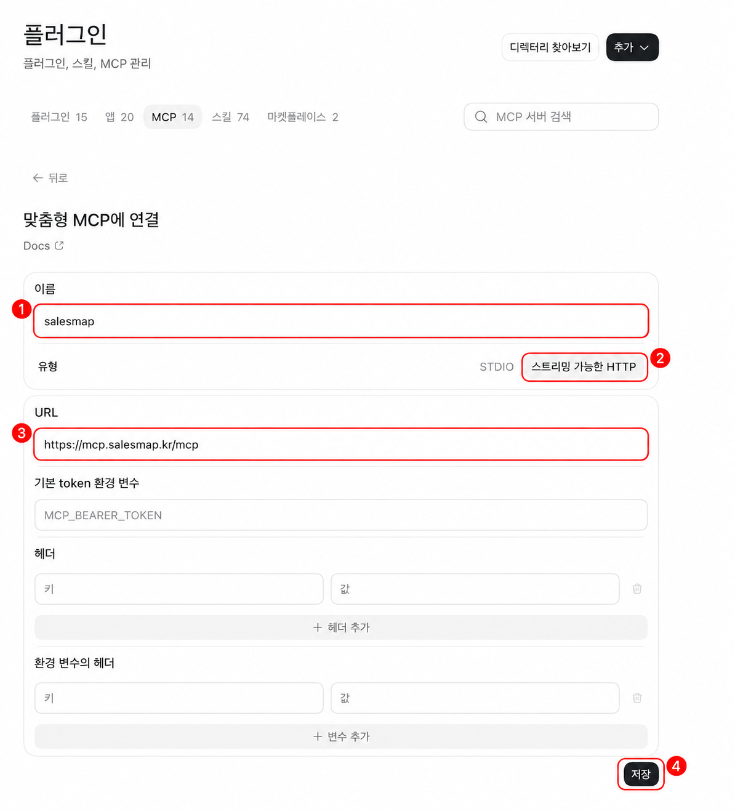
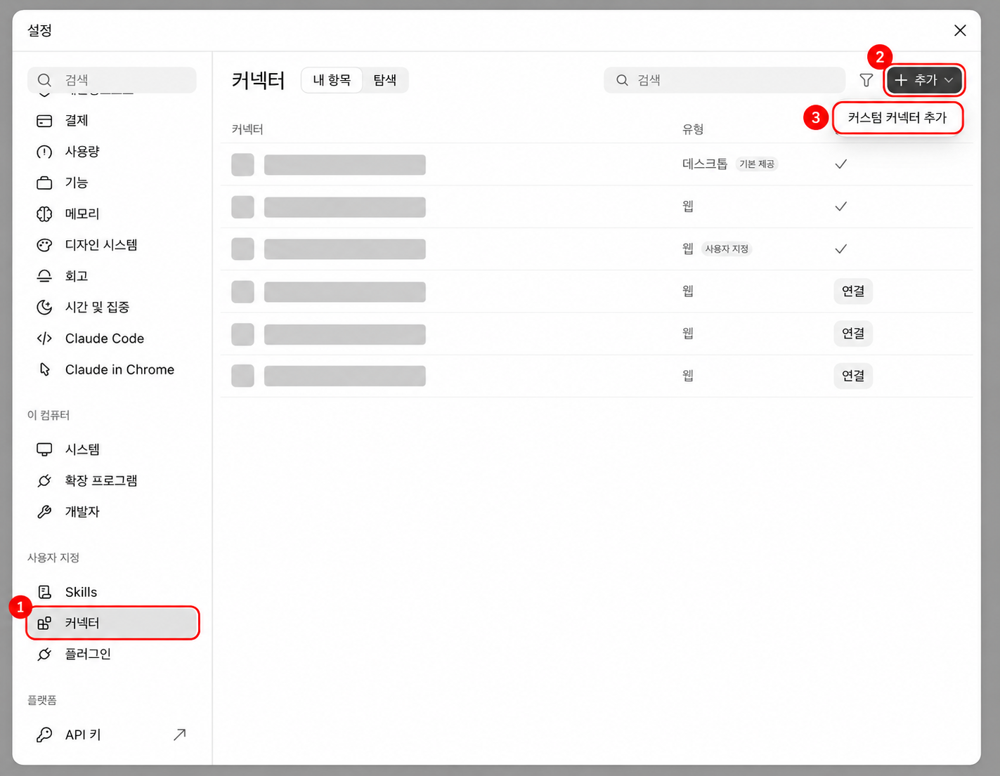
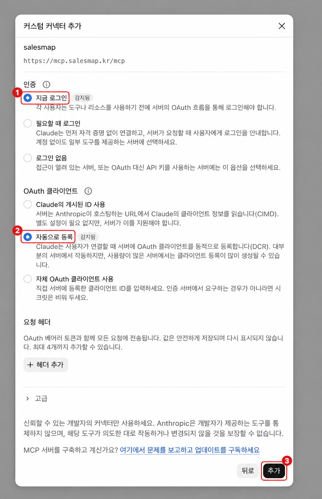
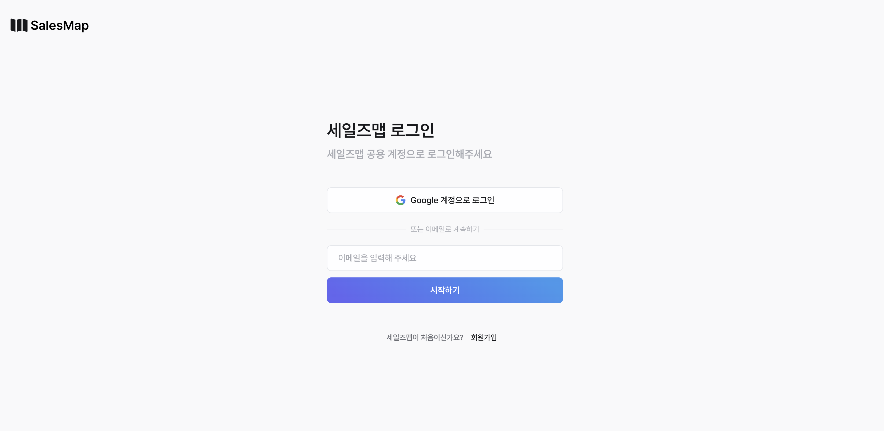
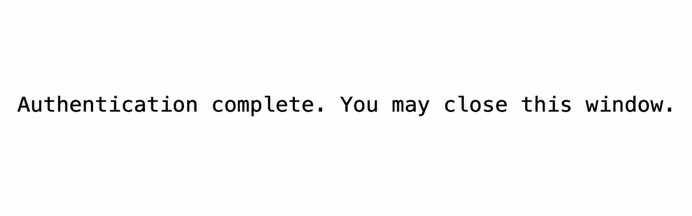

# 세일즈맵 연결하기

아래는 ChatGPT(Codex)와 Claude 데스크톱 앱 기준입니다. 사용하는 앱의 탭을 선택하고 순서대로 진행하세요.

### 1. 앱에 세일즈맵 추가하기



**플러그인 화면 열기**

앱 맨 왼쪽 세로 메뉴에서 **플러그인** 아이콘을 누릅니다. 아이콘에 마우스를 올리면 이름을 확인할 수 있습니다.

<figure></figure>

상단의 **MCP** 탭을 선택합니다. 오른쪽 위 **추가**를 누르고 **MCP 서버 추가**를 선택합니다.

<figure></figure>

**서버 정보 입력하기**

이름에 `salesmap`을 입력하고, 유형은 **스트리밍 가능한 HTTP**를 선택합니다. URL에는 아래 주소를 입력합니다.

`https://mcp.salesmap.kr/mcp`

나머지 입력란은 비워 두고 오른쪽 아래 **저장**을 누릅니다.

<figure></figure>

**인증 시작하기**

서버 목록에서 `salesmap`의 **인증** 버튼을 누릅니다.

<figure></figure>

브라우저가 열리면 아래 **2. 세일즈맵에 로그인하기**로 이어서 진행하세요.


**설정 열기**

앱 왼쪽 아래의 계정 이름을 누르고 **설정**을 선택합니다.

<figure></figure>

왼쪽 메뉴에서 **커넥터**를 선택합니다. 오른쪽 위 **추가**를 누르고 **커스텀 커넥터 추가**를 선택합니다.

<figure></figure>

**서버 정보 입력하기**

첫 번째 입력란에 `salesmap`, 서버 주소에 아래 URL을 입력하고 **계속**을 누릅니다.

`https://mcp.salesmap.kr/mcp`

<figure></figure>

다음 화면에서 인증은 **지금 로그인**, OAuth 클라이언트는 **자동으로 등록**을 선택합니다. 나머지는 변경하지 않고 맨 아래 오른쪽의 **추가**를 누릅니다.

<figure></figure>

**연결 시작하기**

`salesmap: 아직 연결되지 않았습니다.` 안내 아래의 **연결**을 누릅니다.

<figure></figure>

브라우저가 열리면 아래 **2. 세일즈맵에 로그인하기**로 이어서 진행하세요.



### 2. 세일즈맵에 로그인하기

**로그인하기**

Google 계정으로 로그인하거나 이메일을 입력하고 **시작하기**를 누릅니다. 화면 안내에 따라 로그인을 마칩니다.

<figure></figure>

**워크스페이스 선택하기**

연결할 워크스페이스를 고르고 **워크스페이스 선택**을 누릅니다. 화면 아래의 로그인 계정도 확인하세요.

다른 계정으로 로그인하려면 **다른 계정으로 연결**을 누릅니다. 이때 해당 브라우저의 세일즈맵에서 로그아웃됩니다.

<figure></figure>

**권한 선택하기**

워크스페이스를 다시 확인합니다. 다른 워크스페이스를 고르려면 옆의 **변경**을 누릅니다.

- **조회만**: 데이터를 찾아보고 싶을 때 선택합니다.
- **조회 및 변경**: 데이터를 만들거나 수정·삭제할 때 선택합니다.

권한을 선택하고 **연결**을 누릅니다. ‘조회 및 변경’을 허용해도 세일즈맵에서 조회 권한만 있으면 조회만 할 수 있습니다.

<figure></figure>

위 화면은 ChatGPT(Codex) 연결 예시로, 화면 상단에 ‘Codex 연결’이 표시되어 있습니다.

### 3. 앱으로 돌아가기



**Authentication complete. You may close this window.** 메시지가 나오면 브라우저 창을 닫고 ChatGPT(Codex) 앱으로 돌아갑니다.

<figure></figure>


**커넥터 연결을 완료하시겠습니까?** 화면이 나오면 본인이 시작한 연결인지 확인하고 **계속 연결**을 누릅니다.

<figure></figure>

브라우저에서 **Claude을(를) 여시겠습니까?**라고 물으면 **Claude 열기**를 누릅니다.

<figure></figure>



### 4. 연결 확인하기



ChatGPT(Codex)의 대화 입력창에 아래 요청을 입력합니다.


Claude 앱으로 돌아와 다음 순서로 확인합니다.

1. 대화 입력창 왼쪽 아래의 **+** 버튼을 누릅니다.
2. **커넥터**에 마우스를 올립니다.
3. `salesmap` 오른쪽 스위치가 파란색으로 켜져 있는지 확인합니다. 꺼져 있으면 눌러 켭니다.
4. 메뉴 바깥을 눌러 닫고 아래 요청을 입력합니다.

<figure></figure>



> 지금 연결된 세일즈맵 계정과 워크스페이스를 알려줘.

답변에 나온 계정과 워크스페이스가 맞는지 확인하세요.

연결에 문제가 있으면 세일즈맵 [채널톡](https://salesmap.channel.io/home)으로 문의해 주세요.
