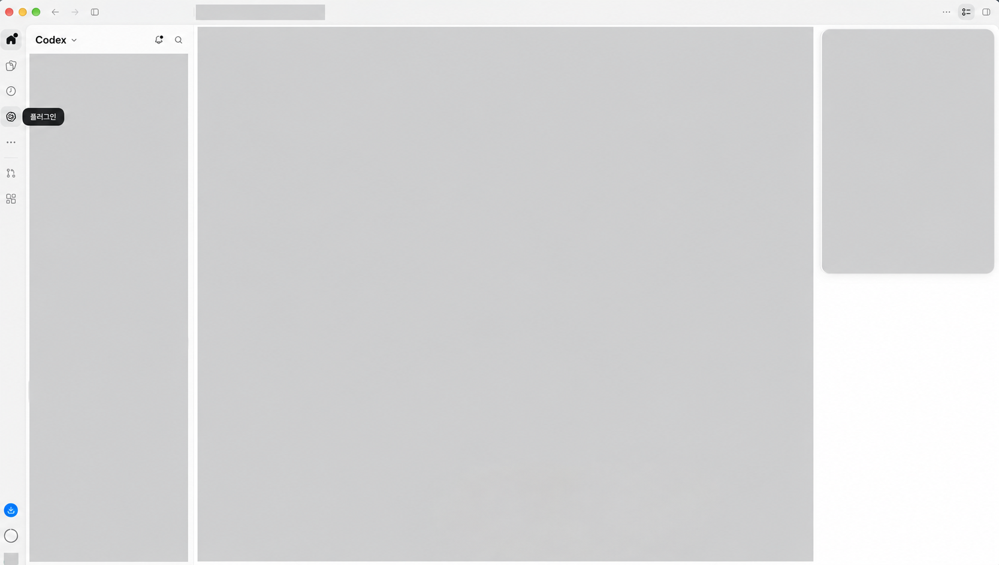
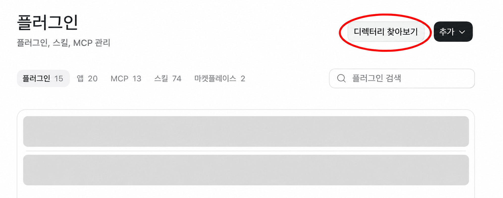
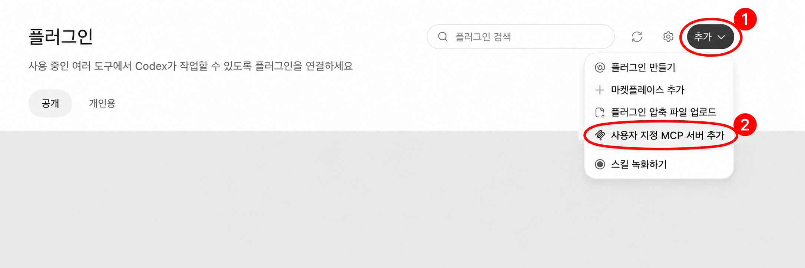
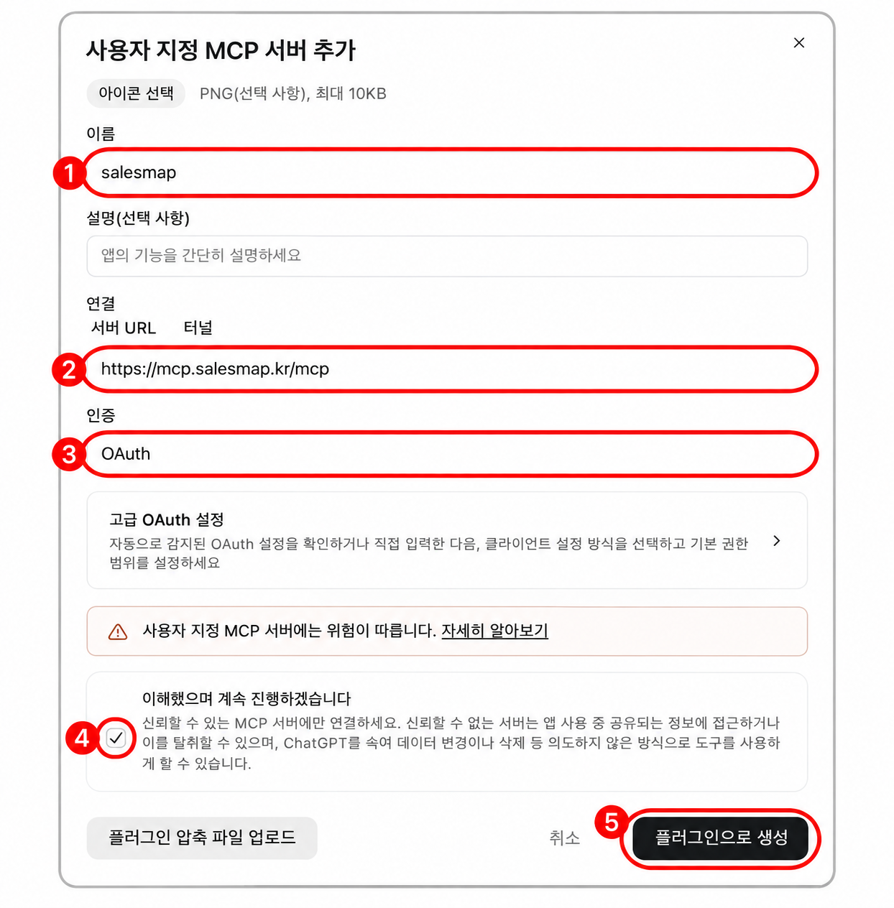
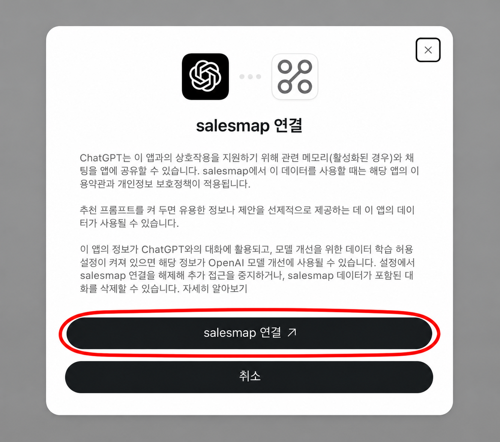
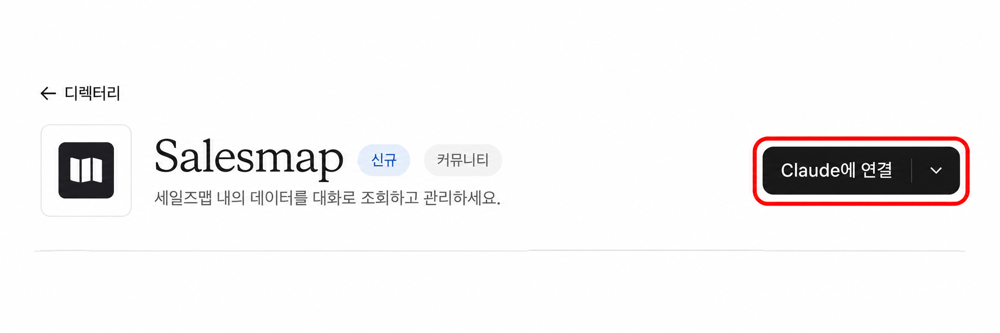
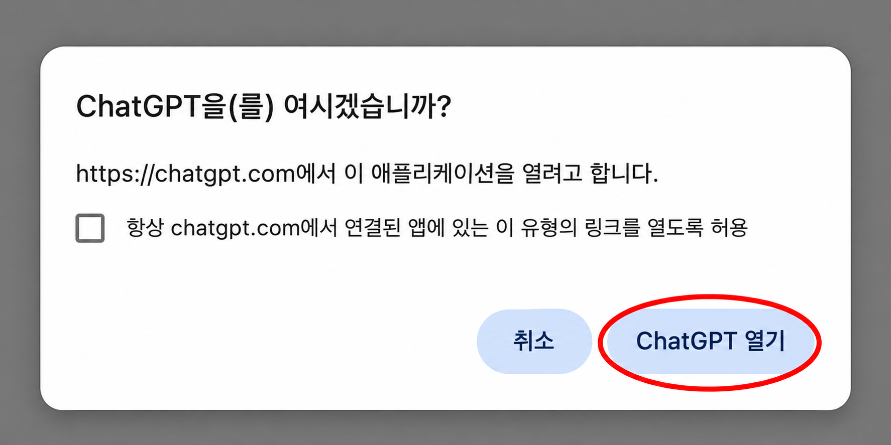

# 세일즈맵 연결하기

사용하는 앱의 탭을 선택하고 순서대로 진행하세요.

### 1. 앱에 세일즈맵 추가하기



아래 순서로 앱에서 세일즈맵을 연결하세요. 같은 ChatGPT 계정으로 로그인한 Codex CLI에서도 사용할 수 있습니다.

**플러그인 화면 열기**

앱 맨 왼쪽 세로 메뉴에서 **플러그인** 아이콘을 누릅니다. 아이콘에 마우스를 올리면 이름을 확인할 수 있습니다.

<figure></figure>

**디렉터리 찾아보기** 버튼이 보이면 눌러서 디렉터리로 이동합니다. 이미 공개 플러그인 목록이 보인다면 바로 다음으로 진행하세요.

<figure></figure>

디렉터리 오른쪽 위 **추가 → 사용자 지정 MCP 서버 추가**를 선택합니다.

<figure></figure>

**서버 정보 입력하기**

이름에 `salesmap`을 입력하고, 서버 URL에 아래 주소를 입력합니다. 인증은 **OAuth**를 선택합니다.

`https://mcp.salesmap.kr/mcp`

주의사항을 읽고 확인란을 선택한 뒤 **플러그인으로 생성**을 누릅니다.

<figure></figure>

**연결 시작하기**

연결 안내를 확인하고 **salesmap 연결**을 누릅니다.

<figure></figure>

브라우저가 열리면 아래 **2. 세일즈맵에 로그인하기**로 이어서 진행하세요.



[Salesmap 커넥터 바로가기](https://claude.ai/directory/salesmap)를 엽니다. Claude 로그인이 필요하면 연결에 사용할 Claude 계정으로 로그인하세요.

**Claude에 연결**을 누릅니다.

<figure></figure>

세일즈맵 화면이 열리면 아래 **2. 세일즈맵에 로그인하기**로 이어서 진행하세요.

같은 Claude 계정으로 로그인한 Claude Code CLI에서도 사용할 수 있습니다. `/mcp`를 입력해 Salesmap 연결을 확인하세요.



### 2. 세일즈맵에 로그인하기

**로그인하기**

로그인 화면이 나오면 Google 계정으로 로그인하거나 이메일을 입력하고 **시작하기**를 누릅니다. 이미 로그인되어 있다면 워크스페이스 선택으로 이어서 진행하세요.

<figure></figure>

**워크스페이스 선택하기**

연결할 워크스페이스를 고르고 **워크스페이스 선택**을 누릅니다. 화면 아래의 로그인 계정도 확인하세요.

다른 계정으로 로그인하려면 **다른 계정으로 연결**을 누릅니다. 이때 해당 브라우저의 세일즈맵에서 로그아웃됩니다.

<figure></figure>

**권한 선택하기**

워크스페이스를 다시 확인합니다. 다른 워크스페이스를 고르려면 옆의 **변경**을 누릅니다.

- **조회만**: 데이터를 찾아보고 싶을 때 선택합니다.
- **조회 및 변경**: 데이터를 만들거나 수정·삭제할 때 선택합니다.

권한을 선택하고 **연결**을 누릅니다. ‘조회 및 변경’을 허용해도 세일즈맵에서 조회 권한만 있으면 조회만 할 수 있습니다.

<figure></figure>

위 화면은 ChatGPT(Codex) 연결 예시로, 화면 상단에 ‘Codex 연결’이 표시되어 있습니다.

### 3. 앱으로 돌아가기



브라우저에서 **ChatGPT을(를) 여시겠습니까?**라고 물으면 **ChatGPT 열기**를 누릅니다.

<figure></figure>



연결을 마치면 사용하던 Claude 앱이나 Claude Code CLI로 돌아갑니다.



### 4. 연결 확인하기



ChatGPT(Codex) 앱에서는 대화 입력창에 아래 요청을 입력합니다.

Codex CLI에서는 같은 ChatGPT 계정으로 로그인한 뒤 `/mcp verbose`를 입력해 `salesmap` 도구가 표시되는지 확인합니다. 확인을 마치면 아래 요청을 입력하세요.


Claude 앱이나 Claude Code CLI에 아래 요청을 입력합니다.



> 지금 연결된 세일즈맵 계정과 워크스페이스를 알려줘.

답변에 나온 계정과 워크스페이스가 맞는지 확인하세요.

연결에 문제가 있으면 세일즈맵 [채널톡](https://salesmap.channel.io/home)으로 문의해 주세요.
