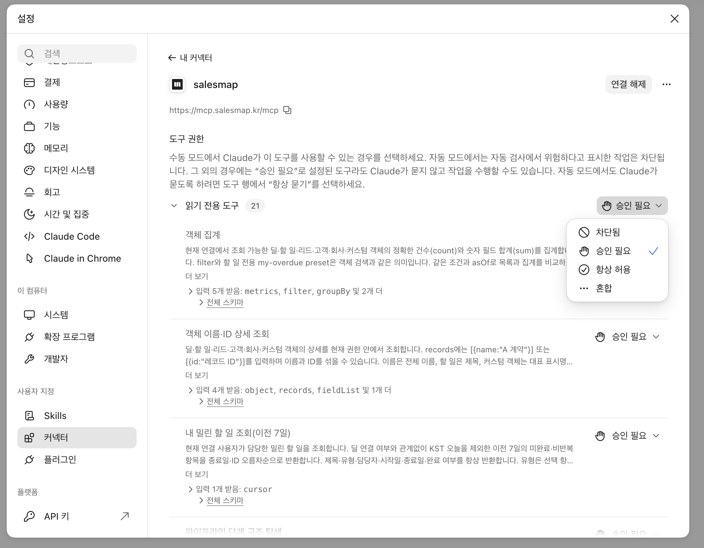

# 사용하기

연결을 마쳤다면 ChatGPT(Codex)나 Claude의 대화 입력창에 요청을 입력하세요. 아래 예시의 이름과 금액은 실제 업무에 맞게 바꾸면 됩니다.

데이터를 만들거나 수정·삭제하려면 연결할 때 ‘조회 및 변경’을 허용해야 합니다. 세일즈맵에서 해당 데이터를 변경할 권한도 있어야 합니다.

### 내 영업 현황 확인

> 내가 담당하는 딜의 이름·단계·금액과 세일즈맵 링크를 보여줘.
>
> 같은 조건으로 딜이 총 몇 건이고 금액 합계는 얼마인지 알려줘.

목록이 여러 페이지라면 “나머지도 보여줘”라고 요청하세요. 전체 건수와 금액 합계는 같은 조건으로 집계해 달라고 하면 됩니다. 딜 금액은 원 단위로 알려주세요.

### 연결된 고객·회사·딜 확인

> ABC 주식회사에 연결된 고객과 딜을 보여줘.
>
> 이 리드에 연결된 고객과 회사를 확인해줘.

딜·리드·고객·회사·커스텀 객체에서 원하는 관계를 지정해 연결된 데이터를 조회할 수 있습니다. 관계마다 현재 조회 권한이 있는 연결 대상만 보여주며, 민감 정보로 지정된 관계의 내용은 가려집니다. 목록이 길면 이어서 보여 달라고 요청하세요.

### 밀린 할 일 확인

> 내가 담당하는 밀린 할 일을 보여줘. 마감일과 연결된 딜도 함께 정리해줘.

“밀린 할 일”처럼 원하는 조건을 함께 말해주세요. 담당자나 미완료 조건이 모든 할 일 검색에 자동으로 적용되지는 않습니다.

### 고객·회사와 딜 생성

> ABC 주식회사에 ‘클라우드 전환 프로젝트’ 딜을 만들어줘. 신규 영업 파이프라인의 제안 단계, 금액은 5,000만원이고 담당자는 나로 해줘.

회사나 단계의 정확한 이름을 알려주세요. 같은 이름의 후보가 여러 개 나오면 원하는 대상을 골라주세요. 필수 입력 항목이 더 있다면 그 값도 알려주세요.

회사도 새로 만들어야 한다면 다음처럼 구분해서 요청합니다.

> ABC 주식회사를 새로 만들고, 그 회사에 홍길동 고객을 만들어 연결해줘. 그 고객에게 서비스 계약 딜도 만들어줘. 딜 단계는 신규 영업 파이프라인의 제안, 금액은 3,000만원이야.

회사, 고객, 딜을 하나씩 만듭니다. 도중에 실패해도 앞서 만든 데이터는 남습니다. 어디까지 만들어졌는지 확인한 뒤 이어서 요청하세요.

### 딜·고객 정보 일괄 수정

> 이 딜 목록의 담당자를 박지성으로 변경해줘. 처리 완료 후 실제로 변경된 건수와 실패한 항목도 알려줘.

일괄 수정은 접수 후 처리됩니다. “접수됐다”는 답변을 받았다면 완료 여부도 확인해 달라고 요청하세요. 결과가 불명확하면 실제 값을 먼저 확인하고, 아직 필요한 변경만 요청하세요.

### 파이프라인 단계별 체류시간

> 클라우드 전환 프로젝트가 각 단계에서 얼마나 머물렀는지 알려줘. 현재 단계는 이번 방문에서 얼마나 지났는지도 구분해줘.

단계에 여러 번 들어갔다면 이전 방문에서 머문 시간과 이번 방문에서 흐른 시간을 나눠 확인할 수 있습니다.

### 고객·딜의 활동 파악

> 클라우드 전환 프로젝트의 최근 활동을 요약해줘. 미리보기만으로 부족한 노트는 전체 내용과 답글도 확인해줘.

최근 활동은 짧은 미리보기로 보여줍니다. 자세히 보고 싶은 항목을 말하면 노트·답글, 공유 이메일 본문, 저장된 녹취를 더 읽을 수 있습니다. 개인 메일함과 첨부파일·오디오는 가져오지 않습니다.

### 노트 기록

> 클라우드 전환 프로젝트에만 오늘 미팅 내용을 노트로 남겨줘. “클라우드 전환 일정 논의. 5월 중 POC 진행 예정. 예산 확보 완료.” 노트 유형은 미팅이야.

노트를 남길 딜과 내용을 알려주세요. 특정 딜에만 남기려면 예시처럼 “이 딜에만”이라고 요청하세요. 노트 유형은 워크스페이스에 등록된 이름을 사용합니다.

### 상품을 선택해 견적 생성

> 클라우드 전환 프로젝트에 ‘도입 견적’ 한 건을 만들어줘. 기존 상품 ‘도입 서비스’를 단가 500만원, 수량 1로 넣고 메인 견적으로 지정하지 마. 필수 추가 필드가 있으면 먼저 알려줘.

견적에 넣을 단가와 수량을 알려주세요. 상품에 등록된 값을 자동으로 가져오지는 않습니다. 구독 상품은 결제 횟수와 시작 결제일도 필요합니다.

견적과 품목의 추가 입력 항목도 이름으로 지정할 수 있습니다. 견적 품목의 값을 지정해도 원본 상품 정보는 바뀌지 않습니다.

> 이 딜에 연결된 견적과 구성 상품을 보여줘.

만든 견적의 합계와 메인 견적 여부도 확인할 수 있습니다.

### 변경 이력 확인

> 클라우드 전환 프로젝트의 금액 변경 이력을 보여줘. 변경자·시각·변경 후 값을 정리해줘.

### 사용자·팀 확인

> 영업팀의 직접 소속 멤버를 보여줘. 비활성 사용자도 상태를 구분해서 알려줘.

목록이 길면 이어서 보여 달라고 요청하세요. 하위 팀 멤버는 포함하지 않습니다. 비활성 사용자의 과거 기록은 찾을 수 있지만 새 담당자로 배정할 수는 없습니다.

### 요청할 때 알아두세요

- 이름이 같은 대상이 여러 개면 후보 중에서 선택하세요. 이름은 중간 띄어쓰기까지 맞춰 입력하세요.
- “나”는 연결할 때 로그인한 세일즈맵 계정입니다. 다른 담당자를 뜻한다면 이름을 알려주세요.
- 날짜, 담당자, 단계 등 원하는 조회 범위를 함께 말해주세요.
- 결과에 나온 세일즈맵 링크를 열어 실제 데이터를 확인할 수 있습니다. 세일즈맵 로그인과 해당 데이터의 접근 권한이 필요합니다.
- 생성·변경 도중 오류나 시간 초과가 나면 실제 처리 여부를 먼저 확인하세요. 같은 요청을 반복하면 데이터가 중복 생성되거나 별도 작업이 접수될 수 있습니다.

### Claude의 실행 승인 설정

Claude의 `salesmap` 커넥터 설정에는 도구별 실행 승인 메뉴가 있습니다.

화면 안내에 따르면 자동 모드에서는 ‘승인 필요’로 설정해도 묻지 않고 실행할 수 있습니다. 자동 모드에서도 확인받으려면 개별 도구 행에서 **항상 묻기**를 선택하세요.

<figure></figure>

### 지원 도구

도구 목록 보기

#### 연결·구조 탐색

| 도구 | 할 수 있는 일 |
| --- | --- |
| `salesmap-get-user-details` | 연결한 계정·워크스페이스와 허용 권한 확인 |
| `salesmap-list-objects` | 사용할 수 있는 딜·고객·회사 등의 종류와 지원 작업 확인 |
| `salesmap-list-properties` | 딜·고객 등에 입력할 수 있는 항목과 필수 입력값 확인 |
| `salesmap-list-associations` | 딜·리드·고객·회사·커스텀 객체에 어떤 종류의 데이터를 연결할 수 있는지 확인 |
| `salesmap-get-pipelines` | 파이프라인과 단계 목록 확인 |
| `salesmap-list-users` | 워크스페이스의 사용자와 현재 상태 확인 |
| `salesmap-list-teams` | 팀과 직접 소속된 멤버 조회. 하위 팀 멤버는 포함하지 않음 |

#### 검색·상세·집계

| 도구 | 할 수 있는 일 |
| --- | --- |
| `salesmap-search-objects` | 조건에 맞는 딜·할 일·리드·고객·회사·커스텀 객체 검색 |
| `salesmap-batch-read-objects` | 딜·할 일·리드·고객·회사·커스텀 객체의 상세 정보 조회. 딜·리드·고객·회사·커스텀 객체는 선택한 관계의 연결 데이터도 조회 |
| `salesmap-aggregate-objects` | 딜·할 일·리드·고객·회사·커스텀 객체의 개수·숫자 합계·그룹별 현황 집계 |
| `salesmap-get-my-overdue-todos` | 현재 사용자가 담당한 이전 7일의 미완료·비반복 할 일 조회. 한국 시간 오늘은 제외 |
| `salesmap-get-stage-durations` | 딜·리드의 단계별 체류시간 조회. 종료된 방문의 누적 시간과 현재 방문에서 경과한 시간을 구분 |
| `salesmap-list-products` | 상품 목록과 금액·상태 등 정보 조회 |
| `salesmap-get-quotes` | 딜·리드에 연결된 견적과 구성 상품 조회 |
| `salesmap-list-sequences` | 시퀀스의 이름·설명·상태·담당자 등 조회. 대상 등록·자동화 실행은 하지 않음 |
| `salesmap-list-webforms` | 웹폼 목록과 기본 정보 조회 |

#### 노트·활동·변경 이력

| 도구 | 할 수 있는 일 |
| --- | --- |
| `salesmap-list-notes` | 작성자·노트 유형·날짜·연결 대상별 노트 조회 |
| `salesmap-list-engagements` | 딜·고객 등에 기록된 활동과 본문 미리보기 조회 |
| `salesmap-read-engagement-content` | 노트 본문과 답글, 공유 이메일 본문, 저장된 녹취 조회 |
| `salesmap-list-changelog` | 딜·고객 등의 항목을 누가 언제 어떤 값으로 바꿨는지 조회 |

#### 생성·수정·삭제

| 도구 | 할 수 있는 일 |
| --- | --- |
| `salesmap-create-object` | 딜·리드·고객·회사·상품·커스텀 객체의 레코드 단건 생성 |
| `salesmap-create-todo` | 할 일 단건 생성 |
| `salesmap-create-note` | 지정한 딜·고객 등에 노트 한 건 작성 |
| `salesmap-create-quote` | 기존 상품을 선택해 딜·리드에 견적 한 건 생성 |
| `salesmap-create-property` | 일반 필드 단건 생성. 노트·관계·계산 필드 생성과 기존 필드 변경은 지원하지 않음 |
| `salesmap-batch-update-objects` | 딜·리드·고객·회사·상품·커스텀 객체에 동일한 필드 변경을 일괄 접수. 할 일·노트·견적 수정은 지원하지 않음 |
| `salesmap-get-update-operation` | 접수한 일괄 수정의 진행 상태와 처리 결과 확인 |
| `salesmap-delete-object` | 딜·리드 한 건 삭제 |

#### 피드백

| 도구 | 할 수 있는 일 |
| --- | --- |
| `salesmap-submit-feedback` | 사용자가 요청한 오류·개선 의견 제출 |

